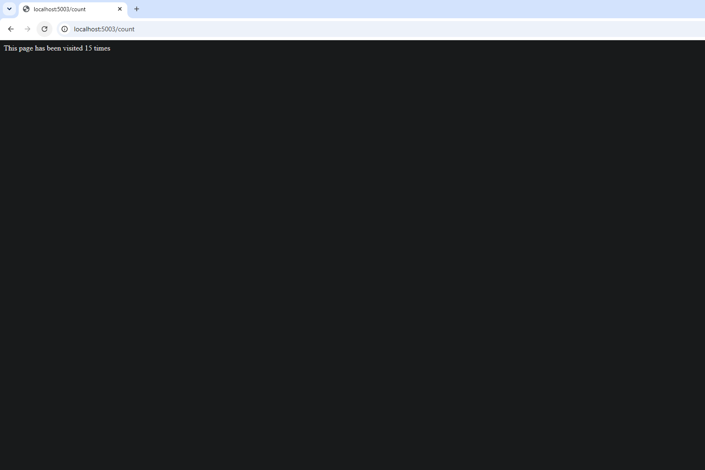
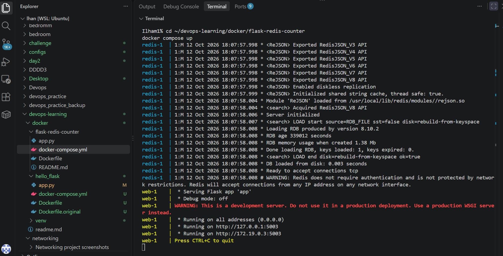
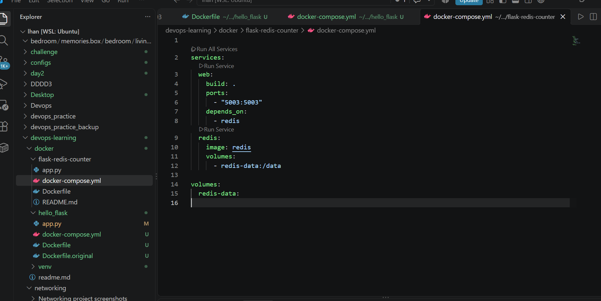
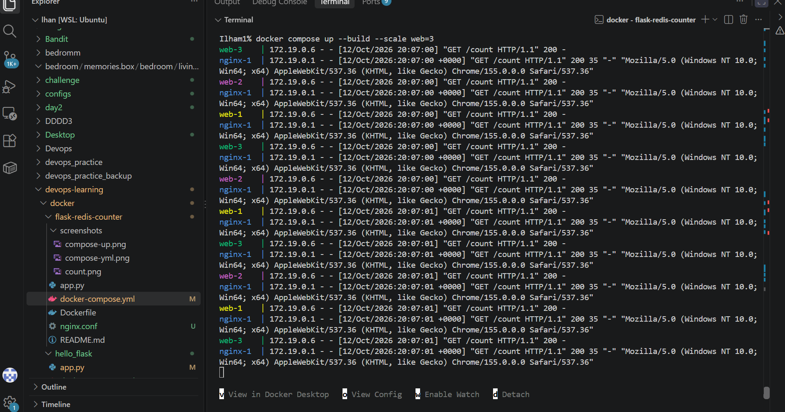

# Flask + Redis Visit Counter

A small multi-container app. A Flask web app counts page visits and stores the count in Redis. An nginx load balancer sits in front, and everything runs together with Docker Compose.

Built as the capstone challenge for the Docker module of the CoderCo DevOps Academy.







## What it does

- `/` shows a welcome message.
- `/count` adds 1 to a visit counter stored in Redis and shows the new total.

## Architecture

Three services share one Compose network:

| Service | Image | Role |
|---|---|---|
| `web` | built from the Dockerfile (`python:3.8-slim`) | Flask app on port 5003, internal only |
| `redis` | official `redis` image | key-value store that holds the counter |
| `nginx` | official `nginx` image | load balancer, the only service exposed on port 5003 |

Flask reaches Redis by its service name (`redis`), not `localhost`. Inside a container, `localhost` means that container itself, so the other service has to be found by name.

```
flask-redis-counter/
├── app.py
├── Dockerfile
├── docker-compose.yml
├── nginx.conf
├── screenshots/
└── README.md
```

## How to run

Requires Docker Desktop.

```bash
docker compose up --build
```

Then open:

- `http://localhost:5003` for the welcome message
- `http://localhost:5003/count` and refresh. The number goes up each time.

Stop it:

```bash
docker compose down      # removes the containers, keeps the saved count
docker compose down -v   # also deletes the volume, so the count resets
```

## Configuration

The Redis connection is not hard-coded. `app.py` reads `REDIS_HOST` and `REDIS_PORT` from environment variables, and `docker-compose.yml` supplies them. Changing the Redis address means editing the Compose file, not the code.

## Persistent storage

Redis keeps its data in `/data`. That folder is mounted on a named volume, `redis-data`, which lives outside the container.

Before the volume, removing the containers reset the count to 1. With the volume, a new Redis container finds the saved data and loads it on start-up, so the counter carries on.

## Scaling

The `web` service can run as several copies behind an nginx load balancer. Only nginx is exposed on port 5003. It passes each request to one of the `web` containers over the Compose network, and all of them share the same Redis, so the counter stays correct.

```bash
docker compose up --build --scale web=3
```

The logs below show three `web` containers taking turns, with nginx in front:



`nginx.conf` holds the proxy rule, and `docker-compose.yml` mounts it into the nginx container.

## What I learned

- Inside a container, `localhost` is the container itself. Services find each other by their Compose service name.
- A container's data disappears with the container unless it is stored in a volume.
- The addresses a container prints (such as `127.0.0.1` or `172.x.x.x`) are internal. The port mapping in `docker-compose.yml` is what makes the app reachable from my browser at `localhost:5003`.
- Settings such as the Redis host and port belong in environment variables, so the same image can run in different places without code changes.
- A fixed host port blocks scaling, because only one container can own it. Putting a load balancer in front lets many copies of a service share one entry point.
- `docker compose logs` is the first place to look when something doesn't work.

## Status

- [x] Flask app with `/` and `/count`
- [x] Dockerfile for the Flask app
- [x] Docker Compose with three services
- [x] Bonus: persistent storage for Redis (volume)
- [x] Bonus: environment variables for the Redis connection
- [x] Bonus: scaling the Flask service with load balancing